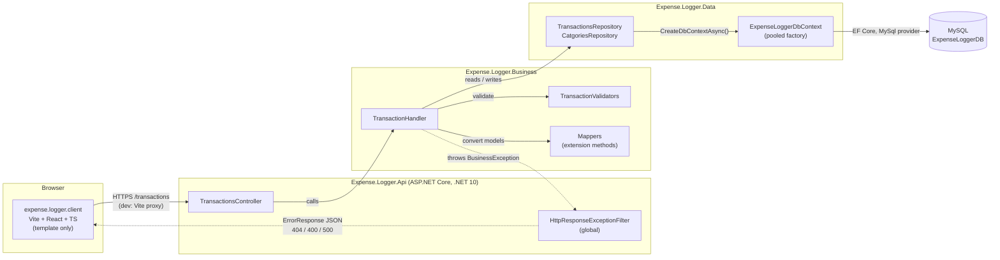
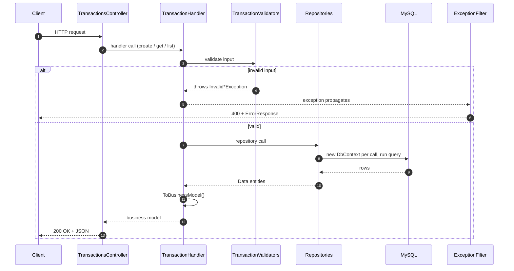
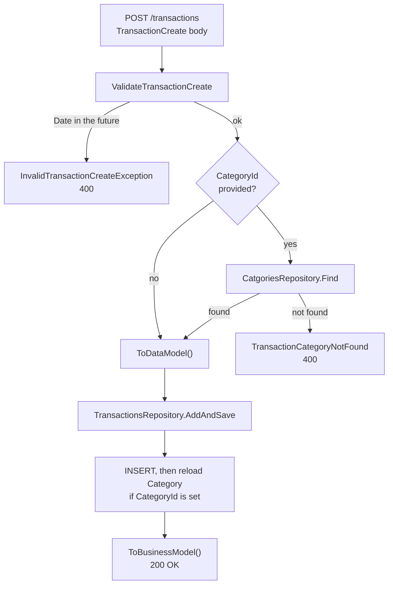
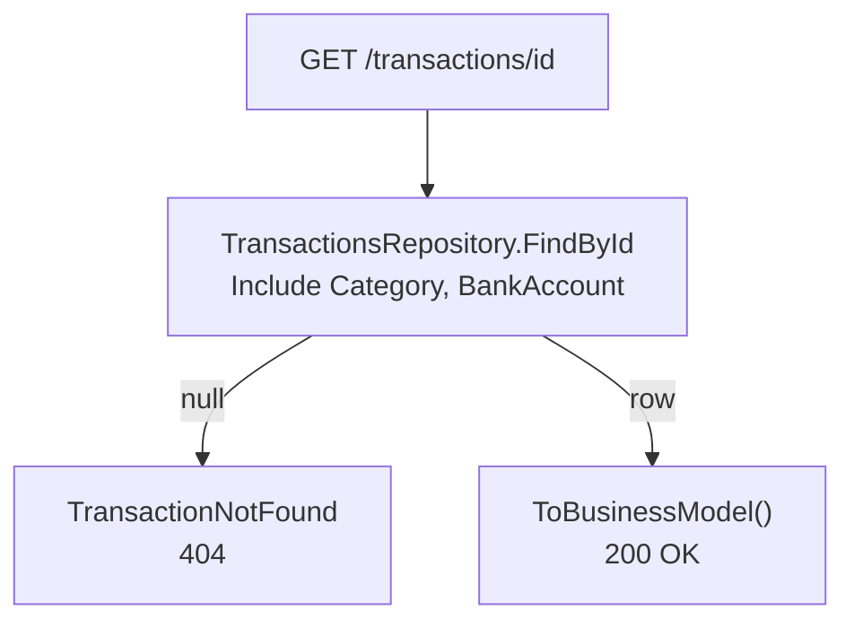
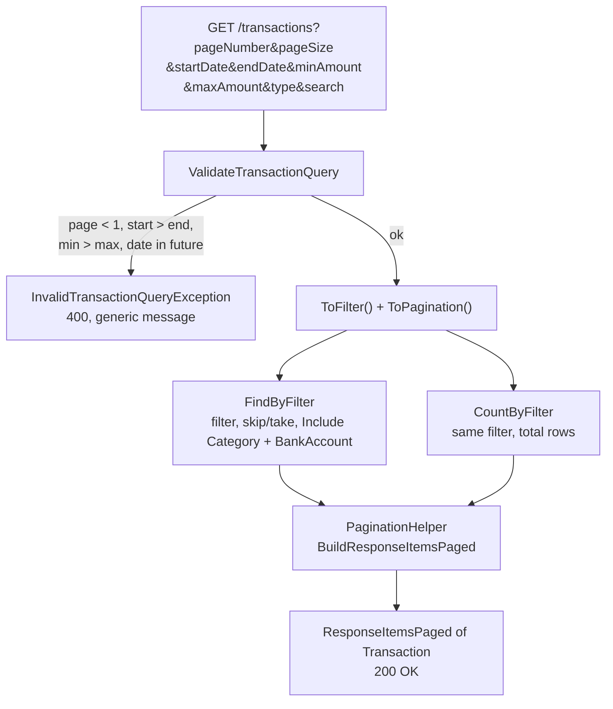
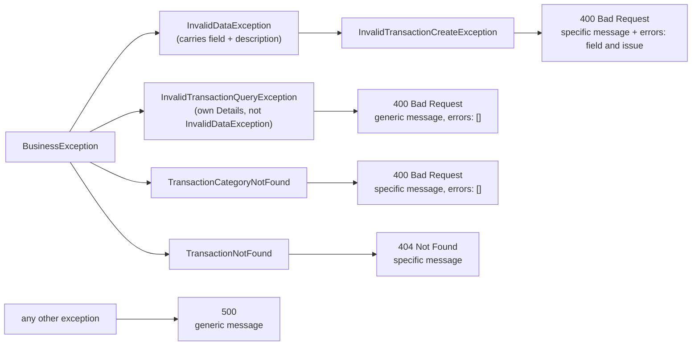
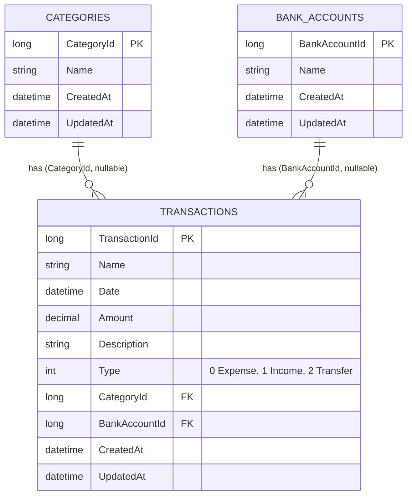
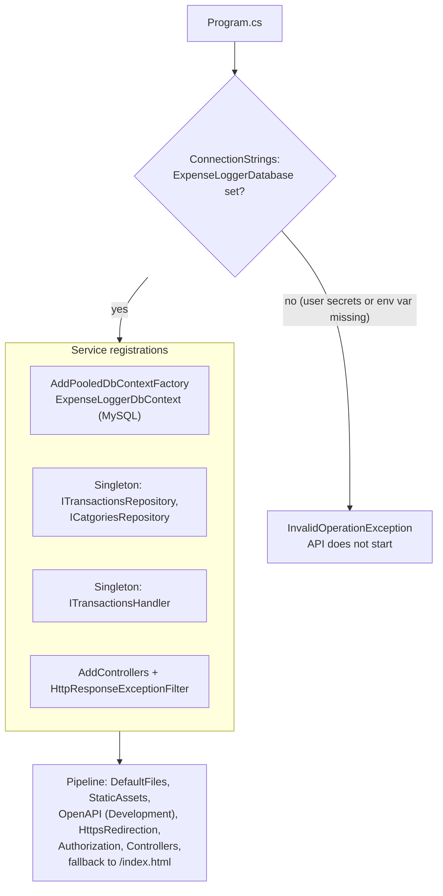
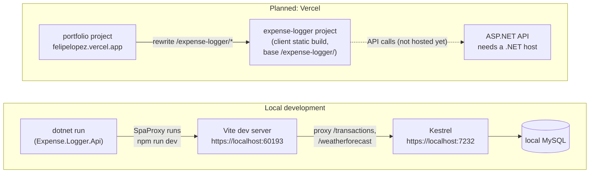

# Architecture and data flow

Diagrams are [Mermaid](https://mermaid.js.org/) and render on GitHub. They describe the code as it is today: only `POST /transactions`, `GET /transactions/{id}` and `GET /transactions` exist, and the React client is still the Visual Studio template.

## 1. System overview

Project references point downward: `Api → Business → Data`. `Business` never sees HTTP types, and `Data` never sees business models.

## 2. Request lifecycle

Controllers have no try/catch. A handler either returns a business model or throws, and the exception filter turns the throw into the HTTP response.

## 3. Per-endpoint flow

### `POST /transactions`

### `GET /transactions/{id}`

### `GET /transactions` (paged and filtered)

The list and the count are two separate queries that share one filter.

## 4. Error mapping

`HttpResponseExceptionFilter` picks the status with a `switch` on the exception type. A new exception type that is not added to that switch is returned as a 500.

The filter only reads `errors[]` and the specific message from `InvalidDataException`. `InvalidTransactionQueryException` has the same `Details` shape but a different base class, so an invalid `GET /transactions` query returns 400 with the generic "unable to complete your request" message and an empty `errors` array. The field that failed is lost.

Every error body is an `ErrorResponse`: `status`, `code`, `message`, `errors[]` (field and issue) and a `requestId`. The `requestId` is a new GUID per error, not a correlation id.

## 5. Data model

Both foreign keys use `ON DELETE SET NULL`, so deleting a category or bank account keeps its transactions. `CreatedAt` and `UpdatedAt` come from `BaseDataModel` and are generated by the database. There are no endpoints for categories or bank accounts yet.

## 6. Startup and dependency injection

Everything is registered by hand in `Expense.Logger.Api/Program.cs`.

Repositories and the handler are singletons, so none of them holds a `DbContext`. Each repository method opens a short-lived context from the pooled factory.

## 7. Local development and deployment

The client Vercel project is not created yet. Vercel cannot run the .NET API, so it has to be hosted somewhere else before the deployed client can show real data.
